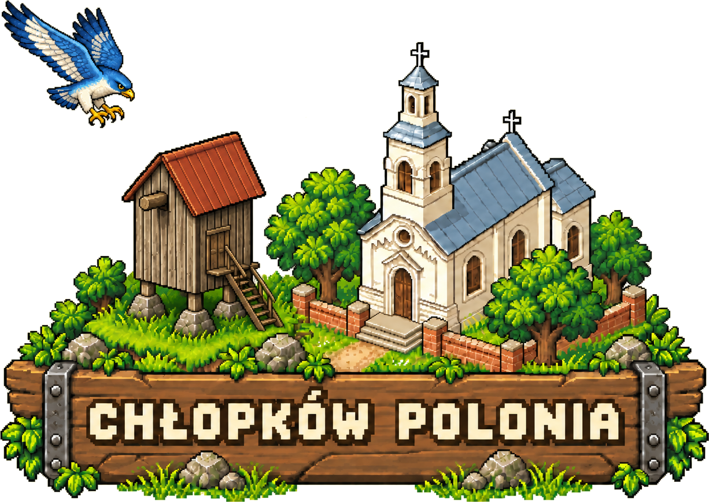
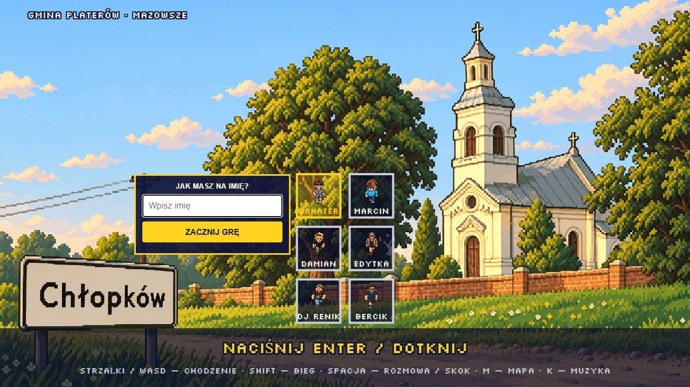
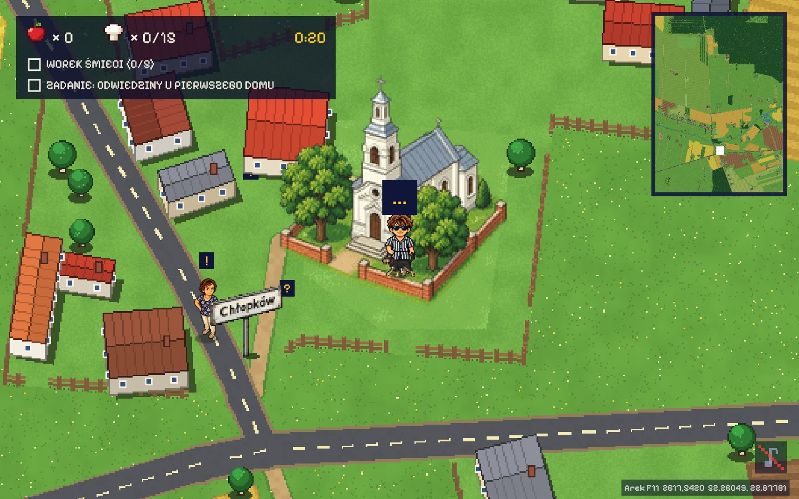
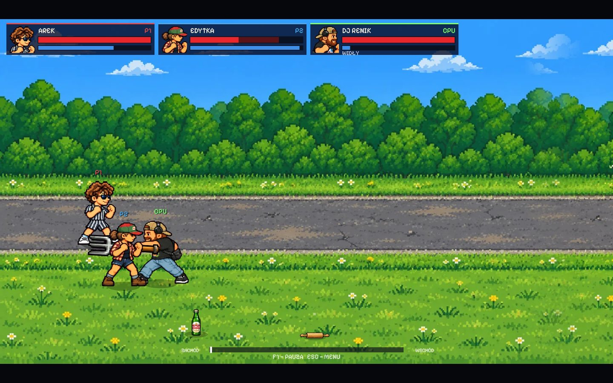
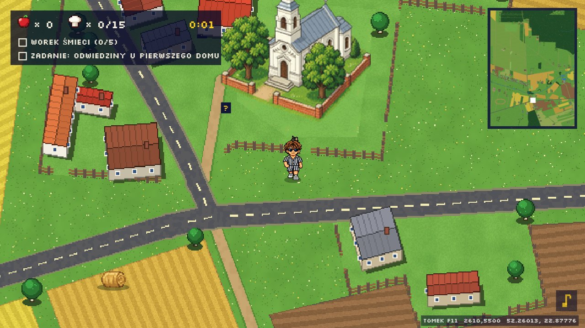
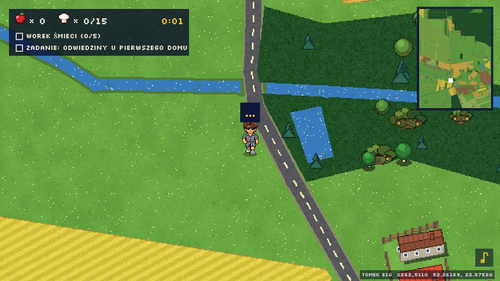
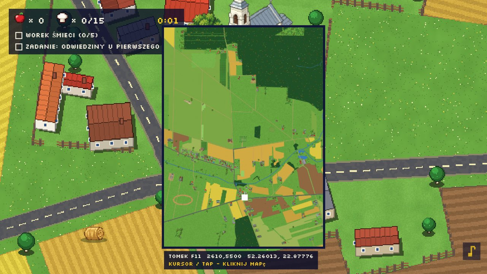

  

  <b>Pikselowa przygoda przez prawdziwą wieś.</b> 
  Gmina Platerów, Mazowsze · przeglądarka, telefon i komputer · bez instalacji i bez konta

  <a href="https://itstomekk.github.io/chlopkow-bolonia/"><b>▶ ZAGRAJ TERAZ</b></a>
  &nbsp;·&nbsp;
  <a href="#-jak-możesz-pomóc">🤝 Pomóż</a>
  &nbsp;·&nbsp;
  <a href="https://github.com/itstomekk/chlopkow-bolonia/issues">💡 Zgłoszenia i pomysły</a>
  &nbsp;·&nbsp;
  <a href="#-o-chłopkowie">📍 O Chłopkowie</a>
  &nbsp;·&nbsp;
  <a href="https://itstomekk.github.io/chlopkow-bolonia/brand-guidelines.html">🎨 Księga znaku</a>
  &nbsp;·&nbsp;
  <a href="DEVELOPMENT.md">🛠️ Dla deweloperów</a>

  

## 👋 Witaj w Chłopkowie

To pikselowa przygoda o wsi, którą najlepiej poznaje się noga po nodze: między domami, kościołem, polami i rzeką Melioranką. Mapa opiera się na danych [OpenStreetMap](https://www.openstreetmap.org/copyright), więc kościół, wiatrak „Koźlak”, cmentarz, boisko i przydrożne kapliczki stoją tam, gdzie stoją naprawdę.

Wybierz bohatera, wpisz imię i ruszaj. Jeśli trafiłeś tu przypadkiem: **[zagraj](https://itstomekk.github.io/chlopkow-bolonia/)**, to kilka minut w przeglądarce. Jeśli znasz Chłopków, **[powiedz nam, czego jeszcze brakuje](https://github.com/itstomekk/chlopkow-bolonia/issues)**. 🧡

## 🚧 Na jakim etapie jesteśmy

**🟡 Grywalna wersja jest na żywo, a gra wciąż rośnie.** Wszystko z listy poniżej działa teraz pod [adresem gry](https://itstomekk.github.io/chlopkow-bolonia/). Gra nie jest skończona: dochodzą nowe postaci, plansze i miejsca.

- **Zmiana nazwy (jeszcze niewdrożona):** obecna nazwa to **CHŁOPKÓW POLONIA**. Wybrana docelowa nazwa to **CHŁOPKÓW LEGENDS**. Adres repozytorium i strony zostaje `chlopkow-bolonia`, żeby linki i zapisy graczy dalej działały.
- **Planowany kierunek (jeszcze nie w grze):** główna misja w stylu przygodówki, w której odkrywasz prawdziwe legendy i historię wsi, oraz start z wyborem psa-towarzysza. To plany, bez obiecanego terminu.

## 🎮 Co tu znajdziesz

| | |
|---|---|
| 🏡 **Wieś do odkrywania** | Domy, pola, las, rzeka i kapliczki. Wypatruj znaków zapytania, bo za każdym kryje się zagadka. |
| 👥 **Mieszkańcy i zadania** | Babcia Irenka prowadzi kronikę Chłopkowa, dziadek Zdzisiek ma swoje sprawy, a wioska skrywa małą tajemnicę. |
| ❓ **Quiz o Chłopkowie** | 13 pytań, każde przypisane do miejsca na mapie. |
| 🕹️ **Minigry** | Łapanie świnki Pepy, psy i jajka, strzelnica, kaczki, koszenie, **bieg na 100 metrów**, **Wojna Płynów** i **Bijatyka** w stylu Little Fighter 2 (kilka osób na jednym urządzeniu plus rywale z komputera). |
| 🐕 **Pies towarzysz** | Za bohaterem chodzi pies (Frodo, a z `?dog=wajper` Wajper). |
| 🎶 **Wieczór na wsi** | W stodole gra jazz. Warto zajrzeć. |
| 💬 **Wspólny czat** | Opcjonalny czat graczy działa na Nostr. Imię i wejście do gry pojawiają się tam publicznie, o czym gra uprzedza przy starcie. |
| 🌍 **PL i EN** | Gra jest po polsku, a wersję angielską włączysz parametrem `?lang=en`. |

## 📸 Z gry

<table>
  <tr>
    <td width="50%"> <b>Wieś</b> z kościołem i znakami zadań (<code>!</code> i <code>?</code>).</td>
    <td width="50%"> <b>Bijatyka</b>: dwie osoby przy jednym komputerze i rywal z komputera.</td>
  </tr>
  <tr>
    <td width="50%"> <b>Kościół</b>, serce wsi.</td>
    <td width="50%"> <b>Melioranka</b>, rzeka, która kręci się przez okolicę.</td>
  </tr>
  <tr>
    <td colspan="2"> <b>Mapa</b> (klawisz <kbd>M</kbd>). Pokazuje, gdzie jesteś.</td>
  </tr>
</table>

## ⌨️ Sterowanie

| | Komputer | Telefon |
|---|---|---|
| Ruch | strzałki lub `WASD`, albo kliknij cel | przeciągnij palcem |
| Bieg | przytrzymaj `Shift` | wychyl drążek do końca |
| Rozmowa, czytanie | `Spacja`, `E` lub `Enter` obok osoby lub rzeczy | przycisk **A** |
| Skok | `X` lub `J` | przycisk **A** |
| Mapa | `M` | dotknij minimapy |

Pełna lista i szczegóły: [DEVELOPMENT.md](DEVELOPMENT.md).

## 🤝 Jak możesz pomóc

Gra powstaje razem z ludźmi, którzy znają Chłopków i lubią pograć. Każda z tych rzeczy naprawdę pomaga:

- 🎮 **Pograj i napisz, co poszło nie tak albo co się podobało.** Zgłoszenie z opisem urządzenia i przeglądarki ([nowe zgłoszenie](https://github.com/itstomekk/chlopkow-bolonia/issues/new)) bardzo ułatwia pracę. Szczególnie przydają się testy na telefonach.
- 🗺️ **Popraw fakty o wsi.** Znasz Chłopków lepiej niż my i widzisz błąd na mapie, w quizie albo w opisie? Daj znać.
- 📖 **Podziel się historiami i legendami miejsca.** Opowieści o Chłopkowie to materiał na planowaną misję. Prosimy bez prywatnych danych osób trzecich.
- 📷 **Zdjęcia miejsc.** Prawdziwe zdjęcia pomagają narysować miejsca tak, jak wyglądają, zob. [PHOTOS-WANTED.md](PHOTOS-WANTED.md). Zdjęcia wysyłaj do Tomka, nie do repozytorium: nigdy ich tu nie publikujemy.
- 💻 **Kod i pomysły.** Pull requesty i pomysły na minigry są mile widziane. Najpierw otwórz zgłoszenie, żebyśmy się nie zdublowali. Jak uruchomić grę lokalnie i testy: [DEVELOPMENT.md](DEVELOPMENT.md).

Kontakt: [zgłoszenia na GitHubie](https://github.com/itstomekk/chlopkow-bolonia/issues) albo [profil @itstomekk](https://github.com/itstomekk).

## 📍 O Chłopkowie

Chłopków jest prawdziwą wsią. Leży w powiecie łosickim, w gminie Platerów, w województwie mazowieckim, na pograniczu z Podlasiem, około 12 km na północny wschód od Łosic. Według danych z 2023 roku mieszka tu około 160 osób.

**[📍 Chłopków na Mapach Google](https://www.google.com/maps/search/?api=1&query=52.265278,22.868611)** · [OpenStreetMap](https://www.openstreetmap.org/?mlat=52.265278&mlon=22.868611#map=15/52.265278/22.868611)

### Skąd ta nazwa i ile ma lat

- Wieś zaczęła się w XV wieku jako **Chłopowo**. Około 1450 roku król Kazimierz IV Jagiellończyk nadał ją niejakiemu Mleczce herbu Korczak.
- W latach 1975-1998 Chłopków należał do województwa bialskopodlaskiego. Dziś jest na Mazowszu, ale historycznie i krajobrazowo to południowe Podlasie.
- Wieś jest sołectwem, ma kod pocztowy 08-210.

### Miejsca, które znajdziesz w grze

- **Kościół.** Murowana świątynia z 1890 roku, dawna cerkiew w stylu bizantyjskim. Wcześniejsze drewniane cerkwie stały tu od przełomu XVI i XVII wieku. Pierwsza spłonęła w 1702 roku od uderzenia pioruna, a kolejne budowano w 1704 i 1786 roku. W 1918 roku świątynię przejęli z powrotem katolicy.
- **Cerkwisko i grodzisko.** Obok kościoła zachowały się ślady wczesnośredniowiecznego grodziska, które mieszkańcy zwą „cerkwiskiem”. Dziś to wzniesienie z płaskim szczytem, a na nim stoi plebania z pierwszej połowy XIX wieku.
- **Wiatrak koźlak.** Drewniany wiatrak, przeniesiony do Chłopkowa w 1949 roku ze wsi Szpaki. Mielił do 1972 roku. Wnętrze zachowało się w bardzo dobrym stanie, ale **skrzydeł nie ma**, dlatego w grze wiatrak też stoi bez nich. Według wpisu z 2019 roku właściciele szukają pieniędzy na odbudowę.
- **Okolica.** W pobliżu wsi są sady, lasy i aleja starych lip. Około dwóch kilometrów dalej stoi zespół pałacowy w Hruszniewie.

Znasz Chłopków lepiej niż my i widzisz błąd? Daj znać. Fakty z tej części pochodzą z publicznych źródeł wymienionych poniżej.

### Źródła i linki

- [Wikipedia: Chłopków (województwo mazowieckie)](https://pl.wikipedia.org/wiki/Ch%C5%82opk%C3%B3w_(wojew%C3%B3dztwo_mazowieckie))
- [Wikipedia: Parafia w Chłopkowie](https://pl.wikipedia.org/wiki/Parafia_Narodzenia_Naj%C5%9Bwi%C4%99tszej_Maryi_Panny_w_Ch%C5%82opkowie)
- [Wikipedia: gmina Platerów](https://pl.wikipedia.org/wiki/Plater%C3%B3w_(gmina))
- [Polinów: Chłopków, południowe Podlasie](https://www.polinow.pl/losice_i_okolice-chlopkow) (historia, kościół, grodzisko)
- [Wiatraki w Polsce: Chłopków](http://www.wiatraki.org.pl/admin/html_wiatrak.php?wiatr_id=378) (wiatrak koźlak)
- [Polska Niezwykła: wiatrak koźlak w Chłopkowie](http://polskaniezwykla.pl/web/place/4533,chlopkow-drewniany-wiatrak-kozlak-(xix-xx-w-).html)
- [Urząd Gminy Platerów](https://w.platerow.com.pl/)
- Dane mapy gry: © współtwórcy [OpenStreetMap](https://www.openstreetmap.org/copyright)

## 🛠️ Dla deweloperów

Gra to czysty JavaScript na canvasie, bez budowania i bez zależności. Katalog [`docs/`](docs/) jest całą stroną, GitHub Pages serwuje go bez zmian. Uruchomienie lokalne, testy, parametry URL do szybkiego testowania (`?dev=1`, `?play=<id>`, `?go=<miejsce>`), struktura repozytorium i licencje są w [DEVELOPMENT.md](DEVELOPMENT.md).

Tablica i wordmark powstają ze skryptu `gen/brand/build_brand_assets.py`. Zasady użycia: [księga znaku](https://itstomekk.github.io/chlopkow-bolonia/brand-guidelines.html).

## 📄 Licencje i autorstwo

- Repozytorium nie ma jeszcze pliku `LICENSE`. Jeśli chcesz użyć kodu albo grafik poza tym projektem, najpierw zapytaj w [zgłoszeniu](https://github.com/itstomekk/chlopkow-bolonia/issues).
- Dane mapy: © współtwórcy [OpenStreetMap](https://www.openstreetmap.org/copyright) (ODbL). Czcionka: Silkscreen, SIL Open Font License.
- Grafiki pikselowe powstały w GPT Image i zostały obrobione skryptami z tego repozytorium.

---

🇬🇧 In English

**CHŁOPKÓW POLONIA** (the chosen new name is **CHŁOPKÓW LEGENDS**, not live yet) is a pixel-art adventure set in the real Polish village of Chłopków (Platerów commune, Masovia), built on OpenStreetMap data. It runs in the browser on desktop and phone with no install and no account: **[play it here](https://itstomekk.github.io/chlopkow-bolonia/)** (add `?lang=en` for English). Stage: playable and live, still growing. A story-driven main mission about local legends and a starting dog choice are planned, not shipped.

Want to help? Playtest and [open an issue](https://github.com/itstomekk/chlopkow-bolonia/issues), correct facts about the village, share local stories, or send a pull request. Developer notes are in [DEVELOPMENT.md](DEVELOPMENT.md). There is no LICENSE file yet, so please ask before reusing code or art.

CHŁOPKÓW POLONIA · adres repozytorium zachowuje starszą nazwę <code>chlopkow-bolonia</code>, żeby linki i zapisy graczy dalej działały.

